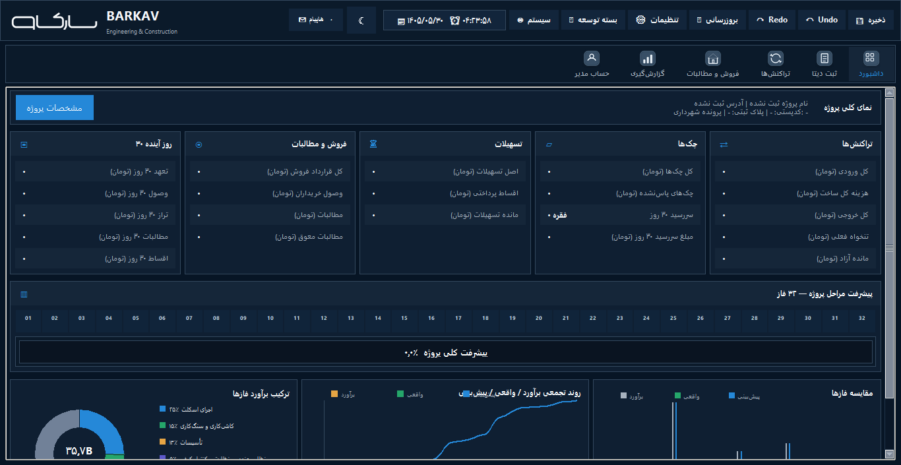
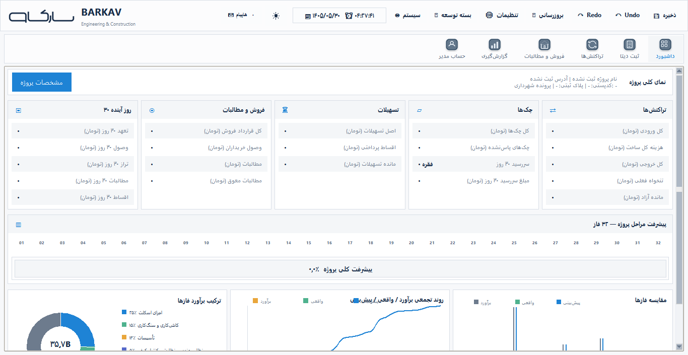

# BARKAV — Engineering & Construction

[](LICENSE)

A Persian (right-to-left) desktop application for the finance, estimating and
project control of a construction project. It is written in Python (Tkinter +
SQLite) and runs on Windows.

BARKAV exists because construction accounting in Iran is a mix of cheques,
instalments, loans, cash payments, contractor statements and receipts that
arrive as photos in a Telegram group. Spreadsheets lose track of which cheque
paid which invoice. BARKAV keeps one SQLite database as the single source of
truth and puts a human approval step in front of everything that touches money.

<p align="center">
  
  
</p>

## What it does

- **Data entry with approval.** Every financial row (expense, payment, cheque,
  cash transaction) is created by approving one Data Entry record, and keeps
  pointing at that record. Nothing financial is posted behind the user's back.
- **Telegram intake.** A bot collects receipts, instalment slips and messages
  from a project group. They land as *pending* items and have no financial
  effect until a person approves them.
- **AI-assisted receipt reading.** Optional OCR and LLM extraction (Gemini,
  OpenAI, Tesseract) fill in a draft record. The user's own caption always
  outranks text printed inside the image, and the result is only a draft.
- **Cheques.** Issue, due, cashed, returned and returned-on-settlement are
  separate states. All "open" and "cashed" decisions go through one module
  (`app/cheque_status187.py`).
- **Loans and instalments.** Annuity schedules, fees, and repayment slips that
  turn into Data Entry records.
- **Sales and receivables.** Buyer contracts, instalments, claims and overdue
  tracking.
- **Contractors.** Contracts, statements and archive per contractor.
- **Estimate by phase.** A 32-phase construction estimate (land, design,
  engineering-council fees, skeleton, installations, finishes, completion, sale) with
  estimated, updated and actual columns.
- **30-day liquidity.** Cheques, instalments and contractor commitments due in
  the next 30 days, against available cash.
- **Reports.** Excel and PDF output with correct Persian shaping, Jalali dates
  and Persian digits.

Financial rules are written down and enforced by tests. The short version:
SQLite is the source of truth, AI and *pending* data never count until approved,
financial deletion is audit-safe, and execution date, invoice date, registration
date, payment date, cheque due date and cheque clearing date are never merged.
The full list is in [`app/AGENTS.md`](app/AGENTS.md).

## Getting started

Requirements: Windows 10 or 11, Python 3.10 or newer (3.13 is what the author
uses), Tcl/Tk (included in the standard python.org installer).

```bat
git clone https://github.com/Pey1364/barkav-desktop.git
cd barkav-desktop\app
py -3 -m pip install -r requirements_18_7_1.txt
BARKAV_19.1.1.bat
```

BARKAV starts at the project hub. Create a project there; its database is
created in `data/` next to `app/`, which is ignored by Git.

Telegram and AI features are optional. To enable them, copy
`app/secrets.local.example.json` to `app/secrets.local.json` and fill in your own
values. That file is ignored by Git and must never be committed.

The reference estimate workbook the author uses contains private project prices
and is not part of this repository. `app/phase_budget_template.xlsx` shows the
expected layout.

## Tests

```bat
cd app
py -3 -m pip install -r requirements_dev.txt
py -3 -m pytest tests\test_cheque_documents187.py -q
```

The suite has 166 test files. Most use a temporary database. Some tests read the
Telegram and AI settings and need a local `secrets.local.json` (copy the example and
fill in placeholder values); without it they fail with a clear message.

On a clean checkout, these tests fail:

- `tests/test_ai_parser_note_type.py`: needs `secrets.local.json` (see above).
- `tests/test_cheque_launcher_flow187.py::test_picker_shows_purpose_amount_due_date_and_receiver_in_persian_digits`: known failure in the author's notes.
- `tests/test_stage18_2_regression.py::test_v182_cash_wizard_step_contract`: fails on the code before this release too.

A full run of every test file, including the Tk ones, has not been completed yet.
Tests that open Tk windows need a desktop session.

Running the tests from `app/` can create `app/data/` (for example
`stage4_test.sqlite3`). That folder is ignored by Git; delete it after a run.

`app/tests/conftest.py` turns an unanswered dialog into a test failure instead
of a hang.

## Repository layout

| Path | What is in it |
|---|---|
| `app/launcher_stage18_7.py`, `app/project_runner_stage18_7.py` | Entry points |
| `app/dashboard_stage18_7.py` | Main shell: dashboard, Data Entry, Transactions |
| `app/finance_db.py`, `app/transaction_lifecycle.py`, `app/record_ownership187.py` | Financial core and the record-ownership rule |
| `app/telegram_stage18_7.py`, `app/telegram_loan_installments187.py` | Telegram bot and instalment slips |
| `app/budget_rich_v163.py`, `app/engineering_phase187.py`, `app/skeleton_phase187.py` | Phase estimate |
| `app/barkav_ui/` | Shared UI: icons, theme tokens, RTL text handling |
| `app/rtl_text187.py` | Right-to-left editing in Tk `Text` widgets |
| `app/docs/` | Architecture notes, UI contract, project-management rules |
| `app/tests/` | Test suite |

The code is layered over earlier stages (`stage15` … `stage18_3`); the files
named `*_stage18_7.py` are the active layer. See `app/AGENTS.md`.

## Built with AI coding agents

This project is developed with AI coding agents (OpenAI Codex and Claude Code)
under written rules: [`AGENTS.md`](AGENTS.md) and [`app/AGENTS.md`](app/AGENTS.md)
define what an agent may change, the financial invariants it must keep, and how
changes are tested before they land. Contributions made with agents are welcome
under the same rules.

## Status

BARKAV is maintained by one person and is used for the books of a real
construction project. It is not yet packaged for general users: the interface is
Persian only, and some setup (Telegram, AI keys) is manual. Issues and pull
requests are welcome, see [CONTRIBUTING.md](CONTRIBUTING.md). To report a
vulnerability, see [SECURITY.md](SECURITY.md).

## License

[MIT](LICENSE). Bundled Persian fonts (Vazirmatn, Shabnam, Samim, Sahel, Parastoo)
keep their own SIL Open Font License; the texts are in `app/assets/fonts/licenses/`.

---

## خلاصه به فارسی

بارکاو یک برنامهٔ دسکتاپ فارسی و راست‌چین برای حسابداری، برآورد و کنترل پروژهٔ ساختمانی
است. پایگاه‌دادهٔ SQLite تنها منبع حقیقت مالی است و هر ردیف مالی فقط با تأیید یک رکورد
ثبت دیتا ساخته می‌شود. دادهٔ ربات تلگرام و خروجی هوش مصنوعی تا تأیید انسان هیچ اثر مالی
ندارند. چک، وام و اقساط، فروش و مطالبات، پیمانکاران، برآورد ۳۲ فازی و نقدینگی ۳۰ روزه از
بخش‌های اصلی‌اند. برای اجرا به ویندوز و Python 3.10 به بعد نیاز دارید؛ دستورها بالا
نوشته شده‌اند. قواعد مالی کامل در `app/AGENTS.md` و قواعد مدیریت پروژه در
`app/docs/rules/PROJECT_MANAGEMENT_RULES_FA.md` است.
