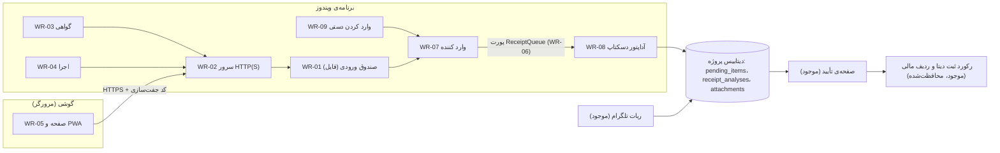

# نقشه‌ی معماری

این سند نقشه‌ی بخش‌های برنامه و قواعد وابستگی آن‌ها را نشان می‌دهد. فهرست کامل ماژول‌ها و شناسه‌ها در [MODULE_REGISTRY.md](MODULE_REGISTRY.md) است. قراردادهای داده و API در پوشه‌ی `app/docs/contracts/` هستند و تصمیم‌های معماری در `app/docs/decisions/`.

## نقشه‌ی جریان رسید

## لایه‌ها

| لایه | ماژول‌ها | قاعده‌ی وابستگی |
|---|---|---|
| انتقال (HTTP) | WR-02، WR-03، WR-04 | فقط به WR-01 و کتابخانه‌های استاندارد وابسته است |
| ذخیره‌سازی | WR-01 | فقط به فایل و Pillow وابسته است؛ دیتابیس و رابط کاربری را نمی‌شناسد |
| کاربرد | WR-07 | فقط به WR-01 و پورت WR-06 وابسته است |
| پورت (مرز) | WR-06 | بدون وابستگی؛ فقط توصیف رفتار |
| آداپتور | WR-08 | وابسته به دیتابیس؛ تنها ماژول وب که `finance_db` را وارد می‌کند |
| فرمان | WR-09 | وابسته به کاربرد و آداپتور |
| پایداری | DB-01، DB-02 | در `finance_db.py`؛ تغییرات فقط افزایشی هستند |
| رابط کاربری (موجود) | Tk و داشبورد | هیچ ماژول WR به آن وابسته نیست |

تست `test_web_receipt_import.py` این قواعد را خودکار بررسی می‌کند: ماژول‌های هسته نباید `finance_db`، `tkinter`، داشبورد یا تلگرام را وارد کنند، و وارد کننده فقط به WR-01 و WR-06 تکیه می‌کند.

## چرا این شکل برای نسخه‌ی جدید مناسب است

- **پورت به‌جای وابستگی مستقیم:** WR-07 فقط `ReceiptQueue` را می‌شناسد. وقتی نسخه‌ی جدید بیاید، یک آداپتور تازه (مثلاً WR-13) کافی است و WR-01 تا WR-05 دست‌نخورده می‌مانند.
- **قرارداد داده‌ی ثابت:** فایل‌های صندوق و پاسخ‌های API به نسخه‌ی قرارداد (`schema_version`، `/api/v1/`) بسته‌اند. تغییر ناسازگار یعنی نسخه‌ی جدید، نه ویرایش نسخه‌ی قبلی.
- **بدون وابستگی به رابط کاربری:** منطق ورود رسید با Tk یا داشبورد قدیمی کار نمی‌کند، پس می‌توان آن را در نسخه‌ی جدید دوباره به کار برد.
- **ایدمپوتنسی:** ورود دوباره‌ی یک رسید ردیف تکراری نمی‌سازد، بنابراین هر آداپتور جدید هم باید همین قاعده را داشته باشد.

## قواعد که هر تغییر باید رعایت کند

1. هیچ ردیف مالی از مسیر رسید وب ساخته نمی‌شود. فقط ردیف صف و پیوست. (قاعده‌ی قرمز، `app/AGENTS.md` بخش ۴)
2. داده‌ی وب تا تأیید انسانی اثر مالی ندارد.
3. تغییر در جدول‌ها فقط افزایشی است. بازسازی جدول یا حذف ستون فقط با تصمیم جدید در ADR انجام می‌شود.
4. تست‌ها فقط روی دیتابیس و پوشه‌ی موقت اجرا می‌شوند، نه روی داده‌ی زنده.
5. عکس‌ها بدون EXIF ذخیره می‌شوند و نام فایل را سرور تولید می‌کند.

## وضعیت فعلی و محدودیت‌ها

- ورود رسید از صندوق به صف فقط با فرمان دستی WR-09 ممکن است. دکمه‌ی برنامه‌ی ویندوز (WR-10) هنوز ساخته نشده است.
- DB-01 روی دیتابیس موقت آزمایش شده است. تمرین روی کپی دیتابیس واقعی هنوز انجام نشده و اجرای روی داده‌ی زنده فقط با اجازه‌ی صریح کاربر انجام می‌شود.
- تأیید رسید وب در صفحه‌ی تأیید موجود هنوز آزمایش نشده، چون کد آن به ستون‌های تلگرام هم وابسته است.
- صفحه‌ی وب روی گوشی واقعی آزمایش نشده است.

## فایل‌ها و جایشان

| مسیر | محتوا |
|---|---|
| `app/web_receipts/` | کد ورودی رسید (WR-01 تا WR-09) |
| `app/web_receipts/static/` | صفحه و دارایی‌های PWA (WR-05) |
| `app/docs/architecture/` | این نقشه، فهرست ماژول‌ها، طرح ورودی رسید |
| `app/docs/contracts/` | قرارداد صندوق و API (`RECEIPT_INBOX_V1.md`) |
| `app/docs/decisions/` | تصمیم‌های معماری (`ADR-*.md`) |
| `app/tests/test_web_receipt*.py` | تست‌های ورودی رسید |

## قاعده‌ی به‌روزرسانی مستندات

هر تغییری که یکی از موارد زیر را عوض کند، باید همان کامیت را به‌روز کند:

- افزودن، حذف یا تغییر مسئولیت یک ماژول: `MODULE_REGISTRY.md` و این سند.
- تغییر فیلدها، مسیرها یا خطاهای صندوق یا API: قرارداد مربوط.
- تصمیم معماری تازه یا تغییر تصمیم قبلی: یک ADR جدید (قدیمی را پاک نکن، وضعیتش را «جایگزین‌شده» کن).
- تغییر در صفحه یا کاربر: `CHANGELOG.md` بخش Unreleased.
