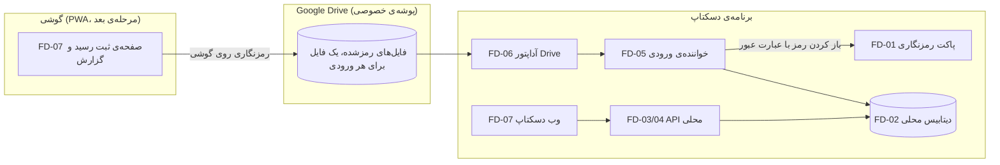

# نقشه‌ی معماری BARKAV Field

BARKAV Field پروژه‌ی جدا برای ثبت رسید و گزارش روزانه از گوشی است. داده‌ها از گوشی به یک پوشه‌ی ابری رمزشده می‌روند و برنامه‌ی دسکتاپ (وقتی باز شود) آن‌ها را می‌خواند و در دیتابیس خودش ذخیره می‌کند. دیتابیس ۱۹.۱.۱ در این پروژه نیست و هیچ تغییری در ۱۹.۱.۱ انجام نمی‌شود.

فهرست کامل ماژول‌ها: [MODULE_REGISTRY.md](MODULE_REGISTRY.md). قرارداد فایل رمزشده: [FIELD_ENVELOPE_V1.md](../contracts/FIELD_ENVELOPE_V1.md). تصمیم‌ها: [پوشه‌ی decisions](../decisions/).

## جریان داده

## لایه‌ها

| لایه | ماژول‌ها | قاعده‌ی وابستگی |
|---|---|---|
| رمزنگاری | FD-01 | فقط کتابخانه‌ی `cryptography`؛ بدون شبکه و دیتابیس |
| ذخیره‌سازی | FD-02 | فقط SQLite و پوشه‌ی تصاویر؛ بدون Drive و بدون API |
| کاربرد | FD-05 | فقط پورت `RemoteInbox`، FD-01 و FD-02 |
| پورت | FD-05 (`RemoteInbox`) | بدون وابستگی؛ توصیف رفتار |
| آداپتور | FD-06 | وابسته به Google Drive؛ تنها ماژول که شبکه‌ی Google را می‌شناسد |
| انتقال (HTTP) | FD-03، FD-04 | فقط FD-02 |
| رابط کاربری | FD-07 | فقط API محلی و (برای گوشی) PWA |

تست‌ها قواعد را بررسی می‌کنند: ماژول‌های هسته به Drive یا Google وابسته نیستند، و FD-05 فقط پورت را می‌شناسد.

## قواعد

1. هیچ داده‌ی مالی در این پروژه ساخته نمی‌شود. رسید و گزارش فقط ورودی‌اند تا وقتی برنامه‌ی ۱۹.۱.۱ (در مرحله‌ی بعد و با تأیید) آن‌ها را بخواند.
2. همه‌ی داده‌ای که از گوشی به Drive می‌رود با عبارت عبور رمزنگاری می‌شود. Google فقط متن رمزشده را می‌بیند.
3. عبارت عبور هیچ‌جا ذخیره یا لاگ نمی‌شود. به‌صورت متغیر محیطی یا ورودی دستی داده می‌شود.
4. تست‌ها فقط روی پوشه‌ی موقت اجرا می‌شوند. داده‌ی واقعی در مخزن نیست.
5. هر تغییر در ماژول‌ها، فهرست و مستندات را در همان کامیت به‌روز می‌کند.

## وضعیت

- FD-01 تا FD-05 و FD-03/FD-04 ساخته شده و با تست پوشش داده شده‌اند.
- FD-06 و FD-06a (Google Drive و ورود) ساخته و با Drive ساختگی تست شده‌اند. ورود واقعی با حساب تست انجام شد و یک رفت‌وبرگشت واقعی (آپلود، خواندن، رمزگشایی، ذخیره) با FD-10 تأیید شد. هنوز تست گوشی به دسکتاپ مانده است.
- FD-09 فرمان `signin` و `pull` را دارد.
- تصمیم یک کلاینت OAuth برای هر دو در ADR-0004 ثبت شده است.
- FD-07 (PWA و وب دسکتاپ) در مرحله‌ی بعد است.
- اتصال به ۱۹.۱.۱ (FD-08) در مرحله‌ی سوم است و با تأیید جداگانه انجام می‌شود.
